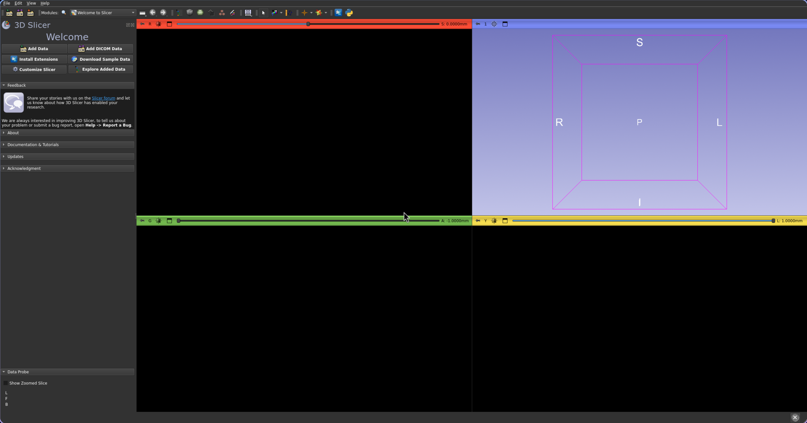

# 3d-slicer-nix



Nix flake packaging the official upstream binary of [3d-slicer](https://www.slicer.org/). This project is not affiliated with or endorsed by upstream.

## Usage

Requires Nix with flakes enabled and x86_64 Linux. From this directory:

```sh
nix run .
nix build .
./result/bin/3d-slicer
```

For a NixOS configuration, add this repository as a flake input and use `inputs.<input-name>.packages.${pkgs.stdenv.hostPlatform.system}.default` in `environment.systemPackages`. Replace `<input-name>` with your chosen input name. The flake pins nixpkgs in `flake.lock`; update deliberately with `nix flake update nixpkgs`.

## NixOS module

Add the input to your NixOS flake (replace the path with the location of this checkout, or use a repository URL):

```nix
inputs.slicer.url = "path:/absolute/path/to/3d-slicer-nix";
```

Import and enable the module in your `nixosSystem` definition:

```nix
outputs = { nixpkgs, slicer, ... }: {
  nixosConfigurations.my-machine = nixpkgs.lib.nixosSystem {
    system = "x86_64-linux";
    modules = [
      ./configuration.nix
      slicer.nixosModules.default
      { programs."3d-slicer".enable = true; }
    ];
  };
};
```

The module is disabled by default and installs the package from this flake when enabled. It does not configure graphics drivers or a desktop environment. For a Git-based input, commit or stage new files before evaluating the flake so Nix can see them.

## Version and licensing

Upstream version: **5.12.4 (Linux AMD64, revision 34645)**. The upstream download URL and integrity hash are in `package.nix`.

3D Slicer Contribution and Software License Agreement; see the [upstream license](https://www.slicer.org/wiki/Documentation/Nightly/License) and bundled component licenses. This repository does not redistribute the upstream binary; Nix downloads it from upstream. Check the upstream terms before use or redistribution. No license is asserted here for the packaging files.

## Known limitations

The upstream x86-64 Linux binary runs in an FHS environment. GPU drivers, extensions, and graphical operation depend on the host and have not been comprehensively tested. 3D Slicer is research software and is not intended for clinical use without appropriate validation. Only x86_64 Linux is provided. Download availability depends on upstream; the fixed hash protects integrity but does not guarantee availability.
